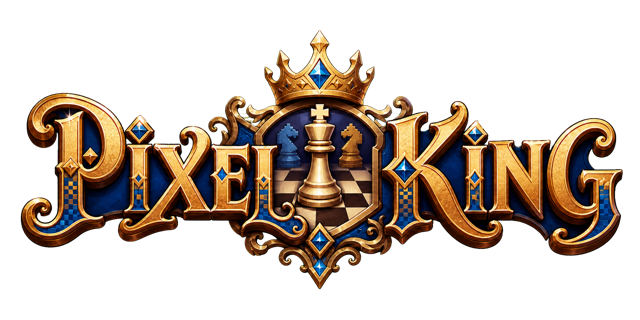
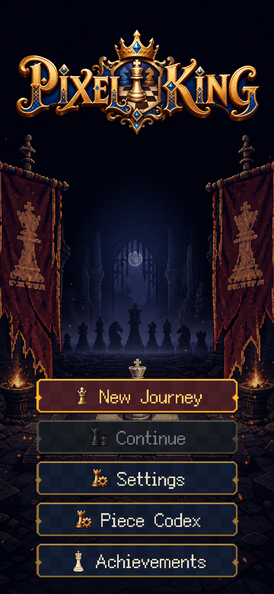
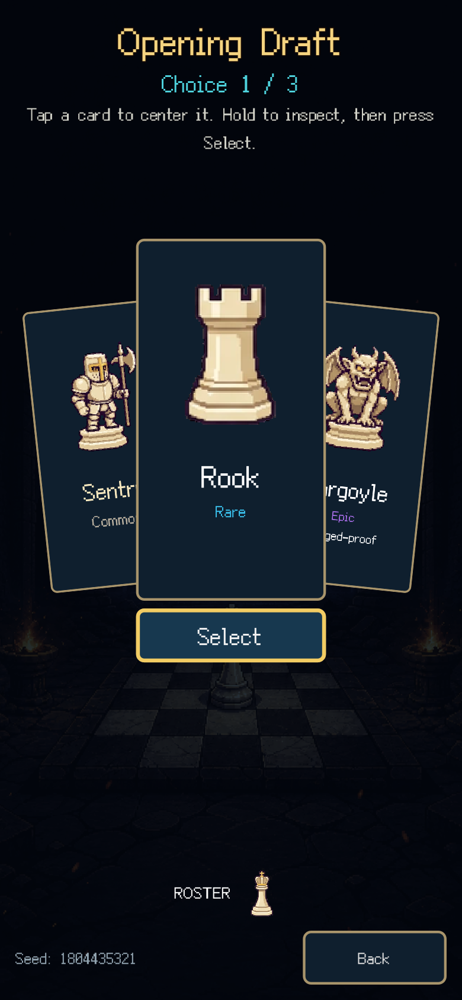
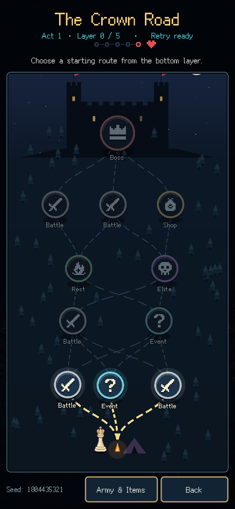
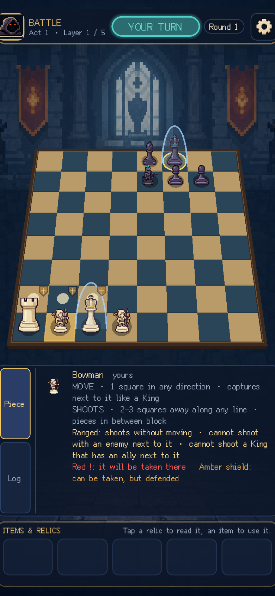

<div align="center">



### A pixel-art chess roguelike — recruit strange pieces, guard your King, march the Crown Road.

**English** · [简体中文](README.zh-CN.md)

[](https://capjunkrat.github.io/pixelking/)
[](https://github.com/CapJunkrat/pixelking/releases/latest)

[](https://github.com/CapJunkrat/pixelking/releases)
[](https://godotengine.org)

[](LICENSE)

&nbsp;
&nbsp;
&nbsp;


</div>

## About

**PixelKing** is a single-player roguelike played on a chessboard. You start with a King and a handful of pieces, then walk the Crown Road: fight battles, visit shops, rest sites and strange events, and grow your army along the way. Lose your King and the run is over.

The pieces don't all follow the rules you know. Archers shoot without moving, catapults lob over rocks, birds hatch from eggs, and some pieces fuse into stronger ones. Every run deals you a different map, different recruits and different enemies.

## Features

- **48 kinds of pieces** — the classic six plus archers, mages, beasts, giants and stranger things, each with its own moves and strike animation.
- **Four Kings** — the classic King plus the War, Shadow and Shield Kings, each with its own reach and ability.
- **Fusion and growth** — combine pieces through 14 fusion recipes; pawns promote, squires level up.
- **The Crown Road** — three acts, nine random bosses, then an endless mode. Elites, shops, rest sites and 12 events along the way.
- **Relics and items** — passive relics and one-shot items that bend the rules.
- **Readable battles** — a tilted 2.5D board that marks threatened and protected squares. Tap any piece, yours or the enemy's, to see what it does.
- **Battle codes** — every battle can be exported as a short code and replayed exactly, handy for bug reports.
- **Achievements**, **English and Simplified Chinese**, and a phone-first portrait layout.

## How to play

| Platform | How |
|---|---|
| **iPhone / iPad** | Open **<https://capjunkrat.github.io/pixelking/>** in Safari, then *Share → Add to Home Screen* to play full screen. |
| **Android** | Download the APK from [Releases](https://github.com/CapJunkrat/pixelking/releases/latest) and install it (allow installs from unknown sources), or play in the browser. |
| **PC / Mac** | Open the [web version](https://capjunkrat.github.io/pixelking/) in any modern browser. |

> [!NOTE]
> The web version keeps your save in the browser. Clearing site data also clears your progress. On iPhone, adding it to the Home Screen makes the save much less likely to be cleared.

## Building from source

**Requirements:** [Godot 4.7](https://godotengine.org/download) (standard build, not .NET). The project uses the Compatibility renderer.

1. Clone the repo and open `project.godot` in Godot.
2. Press <kbd>F5</kbd> to play.

### Tests

```bash
# Everything
godot --headless --path . --script res://scripts/tests/runner/run_all_tests.gd

# Quick pass (skips the slow strike-animation checks)
godot --headless --path . --script res://scripts/tests/runner/run_all_tests.gd -- --quick

# One layer or one domain
godot --headless --path . --script res://scripts/tests/runner/run_all_tests.gd -- --layer=unit
godot --headless --path . --script res://scripts/tests/runner/run_all_tests.gd -- --domain=battle
```

Each test file runs in its own process (6 in parallel by default, `--jobs=N` to change). The runner exits non-zero on any failure.

### Exporting

Install the Godot 4.7 export templates first (Android, and `web_nothreads` for the web build).

```bash
# Android debug APK  → export/PixelKing-debug.apk
godot --headless --path . --export-debug "Android Debug" export/PixelKing-debug.apk

# Web build          → export/web/
godot --headless --path . --export-release "Web" export/web/index.html
```

The web preset is single-threaded, so it runs in iOS Safari and on hosts like GitHub Pages without special headers.

### Project layout

```
scenes/          Godot scenes: ui/, run/ (map, draft, shops…), battle/
scripts/
  core/          Chess rules: board state, move generation, check and mate
  battle/        Battle flow, enemy AI, board view, strike animations
  run/           The run: map, draft, roster, fusion, saves, achievements
  content/       Content registry (data-driven definitions)
  data/          Piece, map, encounter and fusion definitions
  autoload/      Global singletons: settings, audio, localization, run state
  tests/         Test runner and tests (unit / integration / scenes / smoke / e2e)
resources/content/   Pieces, encounters, events, maps… as .tres data
assets/          Art, audio, fonts, shaders
docs/            Design notes and release notes
```

Design notes live in [`docs/`](docs/), starting with [`PIXELKING_PRODUCT_AND_ARCHITECTURE_PLAN.md`](docs/PIXELKING_PRODUCT_AND_ARCHITECTURE_PLAN.md) (Chinese).

## Contributing

Bug reports and ideas are welcome in [Issues](https://github.com/CapJunkrat/pixelking/issues). For a battle bug, tap *Copy battle code* (in the battle menu or on the result screen) and paste it into the issue; it lets the exact battle be replayed.

## License

The code is released under the [MIT License](LICENSE). Third-party assets keep their own licenses, listed below.

## Credits

- **Music** — *Chiptune Medieval* tracks by RandomMind, CC0 ([details](assets/audio/music/CREDITS.md))
- **Sound effects** — [Kenney](https://kenney.nl), CC0 ([details](assets/audio/sfx/CREDITS.md))
- **Item icons** — partly from *496 pixel art icons* by Henrique Lazarini (7Soul1), CC0 ([details](assets/ui/items/CREDITS.md))
- **Fonts** — [Fusion Pixel Font](https://github.com/TakWolf/fusion-pixel-font) (SIL OFL 1.1, see [`licenses/`](licenses/)) and PixelMplus ([readme](assets/fonts/battle/PixelMplus-README.md))
- **Engine** — [Godot Engine](https://godotengine.org)

## Acknowledgements

PixelKing is inspired by chess roguelikes such as [The Ouroboros King](https://store.steampowered.com/app/2096510/) by Oriol Cosp Games. If you enjoy this kind of game, go play it.
