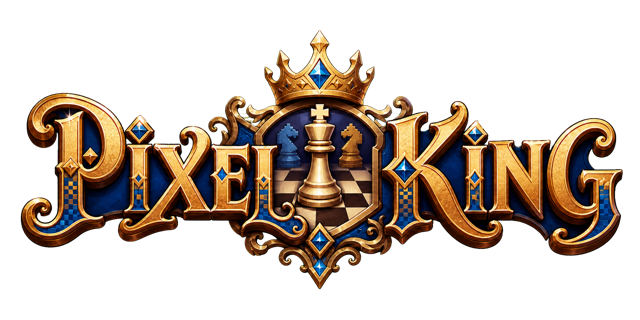
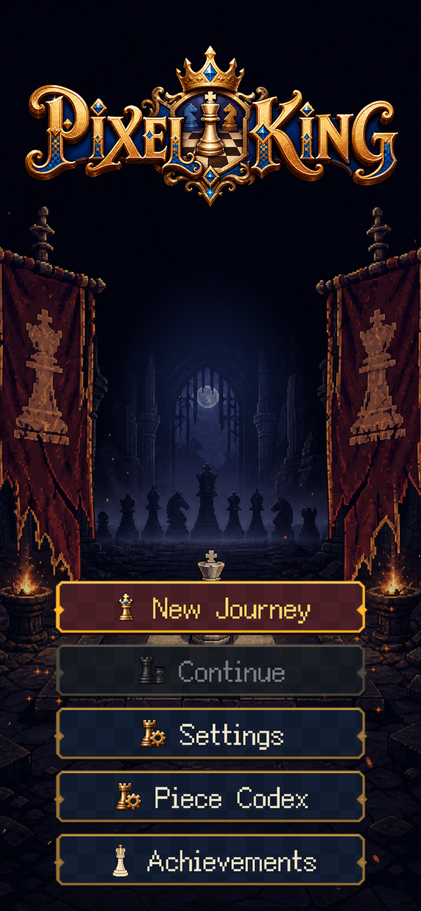
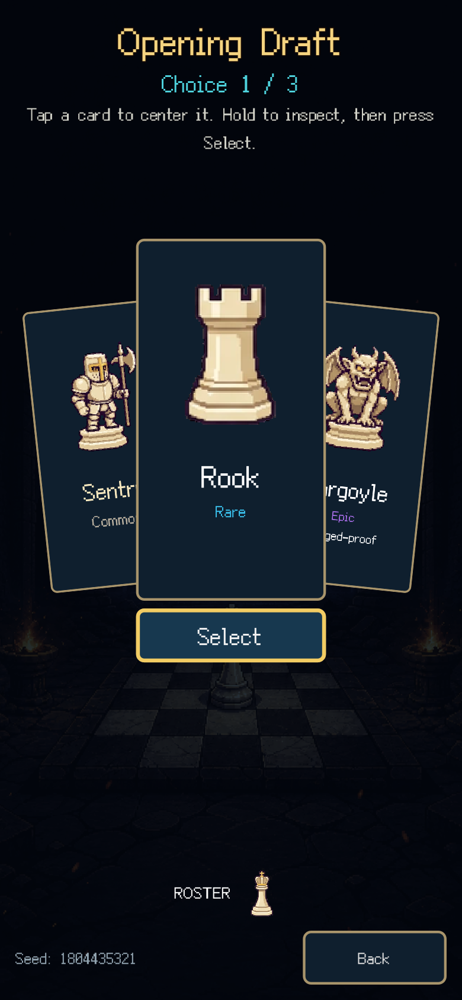
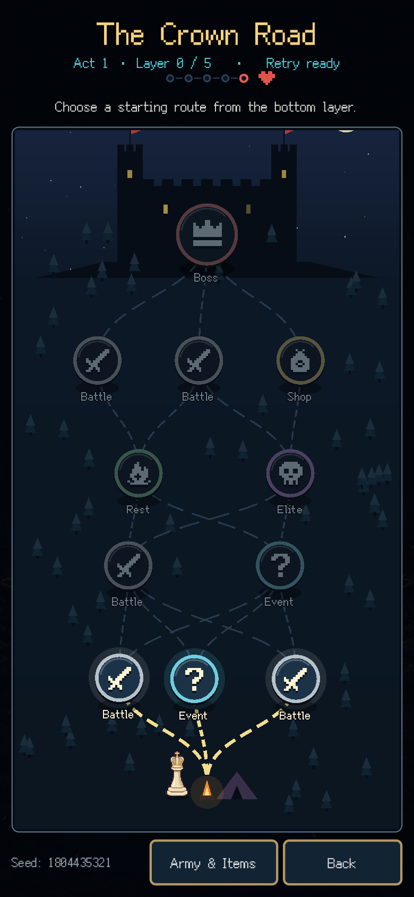
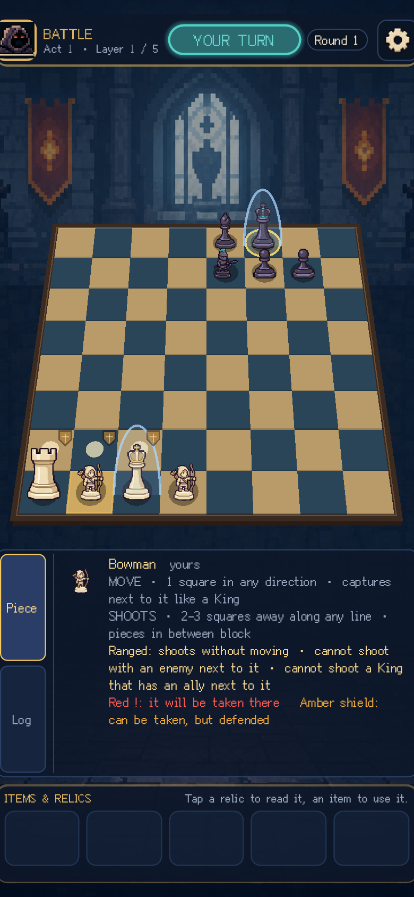

<div align="center">



### 像素风国际象棋 Roguelike —— 招募奇特棋子，守护你的王，踏上王冠之路。

[English](README.md) · **简体中文**

[](https://capjunkrat.github.io/pixelking/)
[](https://github.com/CapJunkrat/pixelking/releases/latest)

[](https://github.com/CapJunkrat/pixelking/releases)
[](https://godotengine.org)

[](LICENSE)

&nbsp;
&nbsp;
&nbsp;


<sub>截图为英文界面，游戏内可切换简体中文。</sub>

</div>

## 简介

**PixelKing（像素国王）** 是一款在棋盘上进行的单人 Roguelike 游戏。你从一位国王和几枚棋子出发，踏上王冠之路：打仗、逛商店、在营地休息、遭遇各种奇怪事件，一路壮大你的军队。国王倒下，这一局就结束了。

这里的棋子并不都守规矩：弓箭手原地射击，投石车越过岩石抛射，鸟从蛋里孵出来，有些棋子还能融合成更强的形态。每一局的地图、招募和敌人都不一样。

## 特色

- **48 种棋子**：经典的六种之外，还有弓手、法师、猛兽、巨人和各种奇怪的家伙，每种都有自己的走法和攻击动画。
- **四位国王**：经典国王，以及战争之王、暗影之王、护盾之王，各有不同的攻击范围和能力。
- **融合与成长**：14 种融合配方；兵可以升变，侍从可以升级。
- **王冠之路**：三幕、九个随机首领，通关后进入无尽模式。沿途有精英战、商店、营地和 12 种事件。
- **遗物与道具**：被动生效的遗物和一次性道具，能改写规则。
- **一目了然的战斗**：2.5D 倾斜棋盘，标出受威胁和受保护的格子。点任意棋子（敌我都行）就能看到它会做什么。
- **对局码**：每场战斗都能导出成一段对局码并原样复现，方便反馈 Bug。
- **成就系统**、**简体中文与英文**、为手机竖屏设计的界面。

## 怎么玩

| 平台 | 方法 |
|---|---|
| **iPhone / iPad** | 用 Safari 打开 **<https://capjunkrat.github.io/pixelking/>**，点"分享 → 添加到主屏幕"，即可全屏游玩。 |
| **安卓** | 在 [Releases](https://github.com/CapJunkrat/pixelking/releases/latest) 下载 APK 安装（需允许安装未知来源应用），或者直接在浏览器里玩。 |
| **电脑** | 用任意现代浏览器打开[网页版](https://capjunkrat.github.io/pixelking/)。 |

> [!NOTE]
> 网页版的存档保存在浏览器里，清除网站数据会同时清掉进度。在 iPhone 上"添加到主屏幕"后，存档就不容易被系统清理了。

## 从源码构建

**环境：** [Godot 4.7](https://godotengine.org/download)（标准版，不是 .NET 版）。项目使用 Compatibility 渲染器。

1. 克隆仓库，用 Godot 打开 `project.godot`。
2. 按 <kbd>F5</kbd> 运行。

### 测试

```bash
# 全量测试
godot --headless --path . --script res://scripts/tests/runner/run_all_tests.gd

# 快速档（跳过较慢的攻击动画检查）
godot --headless --path . --script res://scripts/tests/runner/run_all_tests.gd -- --quick

# 只跑某一层或某个领域
godot --headless --path . --script res://scripts/tests/runner/run_all_tests.gd -- --layer=unit
godot --headless --path . --script res://scripts/tests/runner/run_all_tests.gd -- --domain=battle
```

每个测试文件在独立进程中运行（默认 6 个并行，可用 `--jobs=N` 调整）。有任何失败时返回非零退出码。

### 导出

先安装 Godot 4.7 导出模板（安卓模板，以及网页版需要的 `web_nothreads`）。

```bash
# 安卓调试包  → export/PixelKing-debug.apk
godot --headless --path . --export-debug "Android Debug" export/PixelKing-debug.apk

# 网页版      → export/web/
godot --headless --path . --export-release "Web" export/web/index.html
```

网页版使用单线程模式，因此能在 iOS Safari 上运行，也能直接部署到 GitHub Pages 这类不支持自定义响应头的托管服务。

### 目录结构

```
scenes/          Godot 场景：ui/、run/（地图、选卡、商店等）、battle/
scripts/
  core/          象棋规则：棋盘状态、走法生成、将军与将死
  battle/        战斗流程、敌方 AI、棋盘显示、攻击动画
  run/           一局冒险：地图、选卡、阵容、融合、存档、成就
  content/       内容注册表（数据驱动的定义）
  data/          棋子、地图、遭遇战和融合配方的定义
  autoload/      全局单例：设置、音频、本地化、冒险状态
  tests/         测试运行器与测试（unit / integration / scenes / smoke / e2e）
resources/content/   以 .tres 数据形式存放的棋子、遭遇战、事件、地图等
assets/          美术、音频、字体、着色器
docs/            设计文档与版本说明
```

设计文档在 [`docs/`](docs/) 目录，建议从 [`PIXELKING_PRODUCT_AND_ARCHITECTURE_PLAN.md`](docs/PIXELKING_PRODUCT_AND_ARCHITECTURE_PLAN.md) 开始读。

## 参与贡献

欢迎在 [Issues](https://github.com/CapJunkrat/pixelking/issues) 里反馈 Bug 或提建议。如果是战斗中的 Bug，请点"复制对局码"（在战斗菜单或结算界面里），把对局码贴到 Issue 里，这样就能原样复现那场战斗。

## 许可证

代码以 [MIT 许可证](LICENSE) 发布。第三方素材沿用各自的许可证，见下方列表。

## 素材来源

- **音乐**：RandomMind 的 *Chiptune Medieval* 系列，CC0（[详情](assets/audio/music/CREDITS.md)）
- **音效**：[Kenney](https://kenney.nl)，CC0（[详情](assets/audio/sfx/CREDITS.md)）
- **道具图标**：部分来自 Henrique Lazarini（7Soul1）的 *496 pixel art icons*，CC0（[详情](assets/ui/items/CREDITS.md)）
- **字体**：[缝合像素字体 Fusion Pixel Font](https://github.com/TakWolf/fusion-pixel-font)（SIL OFL 1.1，见 [`licenses/`](licenses/)）与 PixelMplus（[说明](assets/fonts/battle/PixelMplus-README.md)）
- **引擎**：[Godot Engine](https://godotengine.org)

## 致谢

PixelKing 受到象棋类 Roguelike 游戏的启发，尤其是 Oriol Cosp Games 的[《衔尾蛇国王》（The Ouroboros King）](https://store.steampowered.com/app/2096510/)。喜欢这类游戏的话，强烈推荐去玩一玩。
